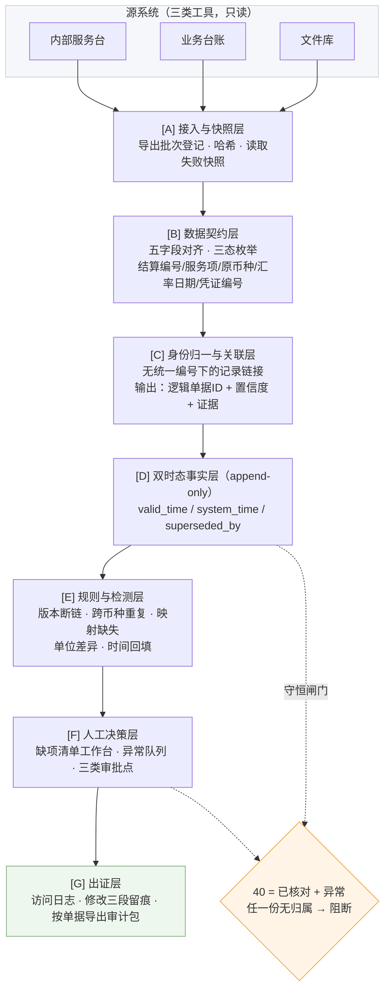
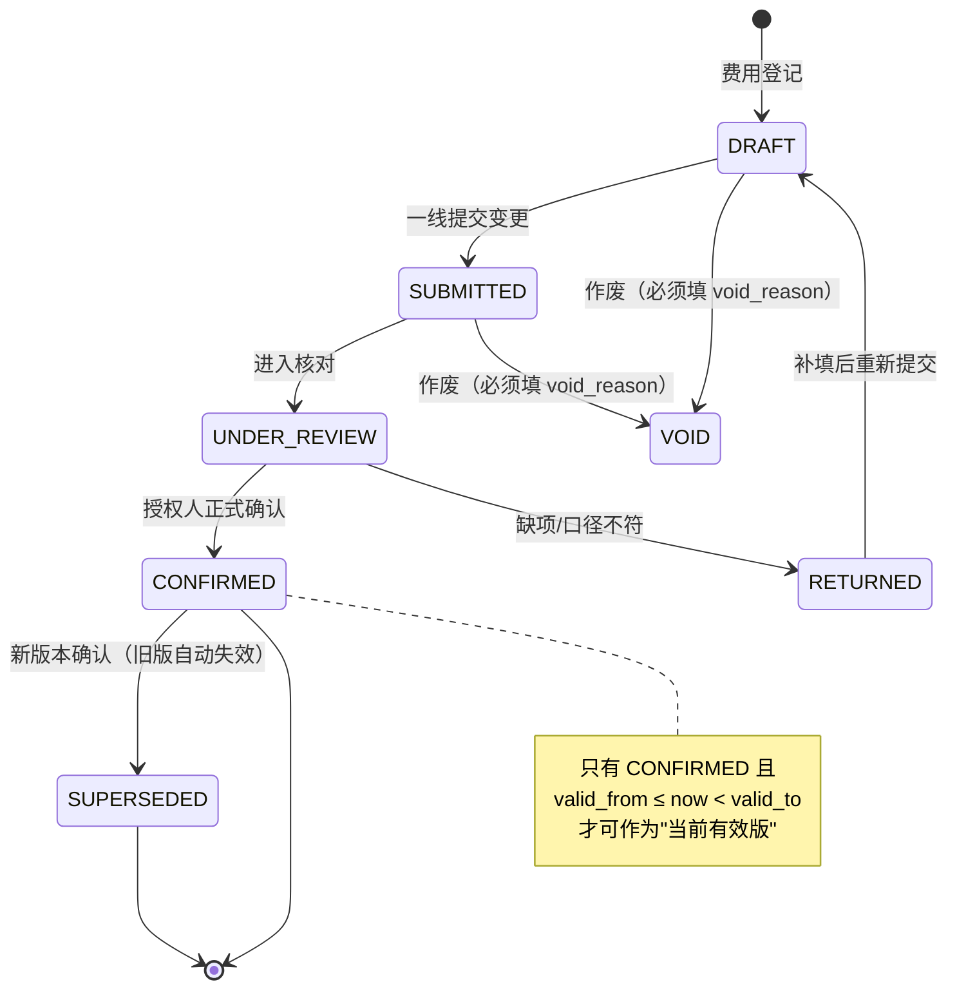

# 代理费用结算与费用追溯 · 试点项目方案

> **方案代号：TRACE**（Trade-settlement Reconciliation & Audit Chain Engine）
> 版本：v1.0 ｜ 编制日期：2026-10-23 ｜ 依据：《业务需求发现报告（贸易服务结算与费用追溯）》
> 适用对象：上海外综服国际贸易有限公司 代理费用结算试点（1 个批次 / 40 份账单 / 4 周）

---

## 0. 阅读前必须知道的三件事

本方案基于一份**演练假设**性质的需求发现报告，其中：

1. **人物、指标、业务问题均为虚构**，仅企业名称与公开业务方向有来源。
2. 报告明确标注的虚构基数为：模拟每月 160 份结算、异常对账每份 55 分钟（`f12`）。**该基线不得作为立项收益测算依据**，试点必须先重测真实基线。
3. 报告中 **Brief（书面需求原文）与 Industry（行业可行性）两个视角为空**，四来源收敛未完成。本方案第 7 章的 GitHub 项目对照，是**为补上 Industry 视角而专门做的第一份材料**，但它只证明"技术上有人这么做过"，不证明"本项目可行"。

因此本方案的定位是：**把 6 条待验证需求假设（REQ-1～REQ-6）翻译成可在 4 周内跑通、可被审计、且失败可回滚的工程边界**。它不是终版需求说明书，第 11 章列出的 8 个阻塞项未澄清前，方案不得进入开发排期。

---

## 1. 问题重述：真正的瓶颈不在流程，在口径

报告的现状链路是清晰的：

```
费用登记 ──▶ 账单核对 ──▶ 客户确认 ──▶ 审批 ──▶ 归档
   │            │             │           │        │
   └─ 交接点1 ──┴─ 交接点2 ───┴─ 交接点3 ──┴─ 交接点4
```

业务负责人顾明岚的判断很关键：**"先观察每个交接点，而不是直接增加自动化"**（`f01`）。这句话排除了"上 OA 审批流 / 上 RPA 自动填单"这类常规答案。

把 6 个角色的陈述放在一起，会看到三个互相咬合的死结：

| 死结 | 表现 | 证据 |
|---|---|---|
| **命名死结** | 费用名称 ≠ 合同服务项，结算说明反复改写，一线无法判断"挂起还是退回" | `f10` |
| **身份死结** | 同一张单据在服务台、台账、文件库三类工具里各有一套身份，**没有统一关联编号** | `f30` |
| **时间死结** | 现场先群消息解决再补填表格，**回填时间不能当作发生时间**，但系统只记了回填时间 | `f13` |

三者叠加的直接后果，就是报告里那个模拟异常：同一笔运输费被不同币种两张凭证重复录入，一线"没法直接判断哪张有效，得先查原始版本"（`f11`）。

**结论：这是数据身份与数据时间的问题，不是审批流问题。** 任何以"加流程节点"为主的方案都会把错误口径固化进系统，而且更难追溯——这正是顾明岚担心的（`f01`）。

由此推出方案的第一原则：

> **本项目不新增任何业务流程节点。它只做三件事：给单据一个稳定身份、给数据两个时间、给每个结论一条回得去的证据链。**

---

## 2. 目标与边界

### 2.1 业务目标（来自 `f00`）

> 让代理费用结算单减少重复核对，**必须保留人工确认和可追溯来源**。

报告特别强调这两点不是二选一。方案把这个约束写成硬指标：效率指标与可追溯指标**必须同时改善**，任一项退化即判定试点失败。

### 2.2 范围内（In Scope）

- 1 个批次的代理费用结算单，共 **40 份**
- 单证类型：代理费用结算单及其关联的费用凭证、合同服务项、汇率口径
- 数据通路：**脱敏只读导出**（`f32`）
- 交付形态：一页缺项清单 + 版本链视图 + 异常队列 + 审计导出包

### 2.3 范围外（Out of Scope，一律不可越界）

依据 `f05`、`f52`、`f32`，以下动作在试点期内**任何情况下不做**，写在代码级约束里而非制度里：

| 禁止项 | 机制级落实方式 |
|---|---|
| 不自动付款 | 系统无付款接口，无金额写回能力 |
| 不确定真实税务处理 | 无税务字段计算逻辑，仅有原文引用 |
| 不修改已确认账单 | 已确认版本在数据库层为 append-only，仅可新增版本 |
| 不写回源系统 | 仅存在 `read` 权限的连接串；无 `INSERT/UPDATE/DELETE` 凭证 |
| 不发外部消息 | 无出站消息通道，通知仅站内 |
| 不替客户做承诺 | 客户侧回复内容无模板生成能力，只做归口转交 |
| 不自动删除疑似重复项 | 见 6.3：`issue` 只能被"关闭并记录理由"，不能物理删除原行 |

### 2.4 资源边界（`f03`）

- 周期：**4 周试点**
- 人力：**2 名业务骨干**，**每周投入 ≤ 4 小时/人**
- 超出即触发重新评估，不得"先做后补"

这条约束直接决定了技术选型必须是**旁路式、零改造、单机可跑**的形态（见第 7 章），而非任何需要源系统配合改造的集成方案。

---

## 3. 需求假设 → 工程需求映射

报告给出 6 条候选需求（REQ-1～REQ-6）。下表把它们转成可开发的功能需求（FR），并绑定验收证据。

| 编号 | 需求假设（报告原文摘要） | 工程需求 | 关键设计取舍 | 验收证据 |
|---|---|---|---|---|
| **FR-1** | 以一页缺项清单+来源位置替代泛化摘要（REQ-1） | 单页工作台：每份账单一行，缺什么、在哪、影响哪一行 | **不做摘要、不做自然语言报告**。刻意放弃 LLM 生成长文本，因为 `f15` 明确说"不需要一份很长的泛化摘要" | 40 份逐份核对，清单字段与来源定位经傅景按 `f42` 抽检 |
| **FR-2** | 版本有效期 + 确认状态双条件判定最新版（REQ-2） | 版本链引擎：双条件唯一定位当前有效版；作废留原因 | 拒绝文件名推断、拒绝 `updated_at` 最大值推断 | 选取 1 个批次人工梳理版本链，验证双条件能否唯一确定 |
| **FR-3** | 跨币种重复费用只提示不删除，保留原始版本（REQ-3） | 三层重复识别 + 证据包；原行永久保留 | **输出的是"候选对+维度分解"，不是"重复结论"** | 合成跨币种样本，验证提示可解释、原行未丢 |
| **FR-4** | 区分业务发生时间与系统接收时间（REQ-4） | 双时态事实层：`valid_time` + `system_time` | 过期来源不得覆盖已确认新版本，做**写入前校验**而非事后纠正 | 只读导出样本标注两类时间，抽查回填场景 |
| **FR-5** | 正式结论确认/异常放行/跨企业资料访问设为人工审批点并留痕（REQ-5） | 三类审批点 + 访问日志 + 修改三段留痕 | 模型**无审批权限**（`f22`），审批动作只由人产生 | 合成单据走一遍三类审批点，检查能否按单据导出 |
| **FR-6** | 工时/返工/确认完整率多指标评估（REQ-6） | 指标看板 + 每周误报漏报复盘台账 | 拒绝单一效率指标；先澄清跨团队目标再定工具 | 四周试点数据 + 一次跨团队口径确认会纪要 |

### 3.1 非功能需求（NFR）

| 编号 | 约束 | 来源 | 验证方式 |
|---|---|---|---|
| NFR-1 | 只读：无任何写回通路 | `f32` | 连接凭证权限审计 + 代码扫描无 `INSERT/UPDATE` 对源库 |
| NFR-2 | 缺失值 ≠ 未确认值，必须三态区分 | `f31` | 数据契约层枚举强制，禁止 `NULL` 兜底 |
| NFR-3 | 问题记录必须保留原行，不清洗痕迹 | `f33` | 原行表 append-only，任何处理只增不改 |
| NFR-4 | 读取失败保留上次快照并标记时间，不编造、不静默重试 | `f35` | 故障注入测试：断开源后系统必须降级为"快照+时间戳+待人工核查" |
| NFR-5 | 每条结果关联来源与人工复核记录 | `f42` | 出证包完整性校验，缺一字段即阻断导出 |
| NFR-6 | 访问记录不能只留最终摘要，需含"谁查过/哪个版本/什么建议/谁确认" | `f45` | 审计抽查：任取 1 份单据能否还原完整决策路径 |
| NFR-7 | 练习结束可按项目约定删除虚构个人字段 | `f43` | 提供按字段的脱敏批处理脚本 + 删除留痕 |

---

## 4. 目标架构

### 4.1 架构原则

1. **旁路只读**：系统长在源系统外面，不改造服务台/台账/文件库。
2. **窄腰（Narrow Waist）**：所有能力收敛到"稳定身份 + 双时态事实"这一层，上层规则可随时替换。
3. **只产 Issue，不改数据**：检测层的一切输出都是"待人工判断的问题对象"，而非"已修正的数据"。
4. **守恒闸门**：任何环节不得让单据静默消失。40 份进，40 份必须有归属。
5. **可解释优先于准确率**：宁可少提示，不可给无法解释的提示。这是 `f42`「不自动删除」的工程化表达。

### 4.2 分层结构



### 4.3 为什么是这个形状

| 常见方案 | 为什么不选 |
|---|---|
| 上 OA/审批流系统 | 现状链路已有 5 个节点，问题不是节点少，是节点间口径不通（`f01`） |
| 直接对接 ERP 做自动对账 | 无统一关联编号（`f30`）、写回不开放（`f32`），自动对账会放大错误 |
| 让 LLM 直接生成结算说明 | `f15` 明确要求"缺项清单+来源位置"，长摘要恰好是返工来源；且 `f14` 规定系统建议不能覆盖原值 |
| 自研一套完整结算系统 | 4 周 / 2 人 / 每周 4 小时的预算边界（`f03`）不允许 |

---

## 5. 数据模型

### 5.1 核心表

```
src_export_batch      导出批次：批次号、导出时间、来源系统、行数、文件哈希、是否成功
raw_row               原始行（append-only）：批次号、原行号、原始字段JSON、原行哈希
                     ★ 永不修改、永不清洗，所有证据最终指回这里
settlement_doc        逻辑结算单：doc_id、结算演练编号、客户、批次、关联置信度
doc_version           单据版本：version_no、valid_from、valid_to、confirm_status、
                     void_reason、sys_recorded_at、source_valid_at、superseded_by
fee_line              费用行：doc_id、fee_name_raw、contract_item_id、original_ccy、
                     amount、fx_date、fx_rate、fx_rate_source、voucher_no、line_state
voucher               凭证：voucher_no、ccy、amount、issue_date、source_snapshot
service_item_dict     合同服务项字典：item_id、item_name、aliases[]
fee_name_mapping      名称映射规则：fee_name_raw → item_id、rule_source、
                     confirmed_by、confirmed_at   ★ 未确认的映射不得自动生效
issue                 问题对象：issue_id、doc_id、type、severity、status、
                     disposition_reason、closed_by
issue_evidence        证据位置：issue_id、source_system、doc_ref、row_no、
                     field_name、snapshot_id   ★ 每条 issue 至少 1 条证据
review_task           人工复核任务：issue_id、assignee、due_at、decision、decided_at
approval              审批点记录：doc_id、approval_type、approver、decided_at、note
audit_event           审计事件（append-only，哈希链）：actor、action、target、
                     version_ref、before_hash、after_hash、prev_hash、at
snapshot              快照：snapshot_id、taken_at、source、payload_hash、reason
```

### 5.2 三态枚举（NFR-2 落实）

`f31` 要求"缺失值与未确认值必须区分"。方案的实现是**禁止用 `NULL` 表达业务语义**：

| 状态 | 含义 | 典型场景 |
|---|---|---|
| `PRESENT` | 已采集且有值 | 凭证号已录 |
| `MISSING` | 源头就没有 | 台账未填汇率日期 |
| `UNCONFIRMED` | 有值但未经授权人确认 | 一线填了服务项，业务负责人未确认 |

这三个值在缺项清单、指标统计、审计导出中**必须分别呈现**。"40 份全部有费用来源"这条验收硬线的判定，依赖的正是 `PRESENT` 与 `UNCONFIRMED` 的区分——把两者混成一个空，验收就会失去意义（`f42` 的落地前提）。

### 5.3 版本状态机



**关键约束**：`CONFIRMED` 状态不可被 `source_valid_at` 更早的来源覆盖（`f34`）。该约束在**写入前**校验，不是事后纠正——因为覆写一旦发生即不可撤销。

### 5.4 审批点与权限（`f41`/`f44`/`f22`）

| 审批点 | 触发条件 | 有权人 | 系统行为 |
|---|---|---|---|
| **AP-1 正式结论确认** | 单据所有费用行均为 `PRESENT` 且已复核 | 授权人名单内成员 | 记录审批人、版本号、时间；模型无此权限 |
| **AP-2 异常放行** | `issue` 状态为待处置且影响金额或来源 | 业务负责人 + 审核与质量负责人 | 必须填写放行理由；理由为空则阻断 |
| **AP-3 跨企业资料访问** | 请求超出本方授权范围 | 授权名单 + 客户协同代表确认用途 | 访问前校验范围，访问后写入审计事件 |

> 一线专员可提交变更，但正式确认必须由对应业务负责人完成，**模型没有审批权限**（`f22`）。本方案在代码层把 `approval.approver` 限定为自然人账号，任何系统账号提交审批直接拒绝。

---

## 6. 关键规则设计

### 6.1 最新版本判定（FR-2）

拒绝两种常见但错误的做法：按文件名（`f24` 明确禁止）、按修改时间最大值。

```
当前有效版本 = 满足全部条件的唯一版本 v：
  (1) v.confirm_status = 'CONFIRMED'
  (2) v.valid_from <= now < v.valid_to
  (3) v.superseded_by IS NULL
  (4) v.void_reason IS NULL
若满足条件的版本数 ≠ 1 → 生成 VERSION_CONFLICT issue，进人工队列
```

第 (4) 步是重点：**"双条件无法唯一确定"本身就是一个必须被看见的问题**，不能靠"取最新一条"糊过去。`f44` 要求版本无法确认时进人工队列、必要时暂停试点，这条规则就是它的实现。

### 6.2 跨币种重复识别（FR-3）

**这是全方案风险最高的模块，因此设计成"三层证据、零判定"结构。**

| 层级 | 判据 | 输出 | 强度 |
|---|---|---|---|
| L1 强键 | `voucher_no` 完全一致 | 候选对 + 原行位置 | 高 |
| L2 弱键 + 金额归一 | 同服务项 + 业务发生日 ±N 天 + 同服务对象 + 金额折算后差额 / 较大值 ≤ 容差 | 候选对 + 各维度命中/未命中明细 | 中 |
| L3 语义相似 | 费用名称/摘要归一化后相似度 | 候选对 + 相似度与命中片段 | 低 |

金额归一必须显式记录汇率来源：

```
amount_base = amount * fx_rate
fx_rate_source ∈ {合同汇率, 结算日汇率, 央行中间价, 人工录入}
★ 汇率口径未核实（报告第 3 章明确指出）→ 系统只记录来源，不推断、不默认
★ 若同组两行 fx_rate_source 不同 → 强制降级为 L3，并标注"口径不可比"
```

**输出物形态**（严格遵守 `f02`/`f42`）：

```
{
  "issue_type": "DUP_SUSPECT",
  "candidate_pair": ["row#128", "row#204"],
  "matched_dimensions": ["voucher_no", "service_item", "amount_base"],
  "unmatched_dimensions": ["original_ccy", "fx_rate_source"],
  "evidence": [...],              // 每条指回 raw_row 的原行号与快照
  "suggested_action": "HOLD",     // 仅建议挂起，绝无 DELETE
  "certainty": "MEDIUM"
}
```

系统**没有**"删除""合并""标记为已消除"三种动作。`issue` 的终态只有：`CLOSED_WITH_REASON`（附理由与处置人）、`ESCALATED`（进 AP-2 审批）、`OPEN`。

### 6.3 守恒闸门（对应"40 份全部有费用来源"）

这是全方案最该借鉴外部实践的地方（见 7.4）。核心思想：

```
对任意统计口径：
  已核对份数 + 异常份数 = 该批次总份数
  且 已核对份数 + 异常份数 + 未处理份数 = 40

任一等式不成立 → 阻断出证，报告差额
```

配套**控制总数**校验：导出批次的总金额、总行数必须与源系统对账口径一致；不一致时说明"导出排除了什么"，而不是直接开始匹配。

报告里 40 份这个量级很小，很容易"看着差不多就行"。但正是小样本最容易掩盖"中间漏掉一份"的问题，而漏掉的那份往往就是有问题的。

### 6.4 双时态写入规则（FR-4）

| 字段 | 含义 | 来源 |
|---|---|---|
| `source_valid_at` | **业务发生时间** | 单据/凭证上的业务日期，允许人工补录并标注来源 |
| `sys_recorded_at` | **系统接收时间** | 系统写入时刻，只读、不可人工修改 |

写入时的四条校验：

1. 同一逻辑单据的新版本，若 `source_valid_at` 早于当前已确认版本的 `source_valid_at` → **拒绝覆盖**，生成 `TIME_BACKFILL` issue。
2. 群消息等外部沟通记录**不得**作为 `source_valid_at` 的依据（`f13`），仅可作为备注证据。
3. 读取失败 → 保留上次 `snapshot`，页面显示"数据截至 {taken_at}"+ 待人工核查标记，**不重试业务动作**（`f35`）。
4. 任何 `UPDATE` 在物理上实现为"插入新版本行 + 旧行置 `superseded_by`"，审计可完整回放。

> 这一套机制的本质是双时态（bitemporal）建模：`valid time` 描述业务世界里何时为真，`system time` 描述系统何时知道。第 7 章列出了成熟开源实现可供参照，但试点规模下用"双时间戳列 + append-only 事件表"即可，无需引入数据库依赖。

---

## 7. GitHub 同类项目对照（补 Industry 视角）

> 检索方式：按"发票对账 / 三单匹配 / 双时态 / 记录链接 / 物流计费"五条线分别检索。
> **说明**：下列仓库链接与描述来自检索结果，采用前需二次核验仓库活跃度、许可证与安全状况。许可证信息为检索所得，不构成法律意见。

### 7.1 对照总表

| # | 项目 | 领域 | 可借鉴的部分 | 明确不借鉴的部分 | 许可证（检索所得） |
|---|---|---|---|---|---|
| 1 | [adoptai/cpa-skills · three-way-match](https://github.com/adoptai/cpa-skills) | 审计方法论 + 可执行脚本 | **总体守恒与控制总数思想**：匹配数+异常数必须等于总体；带容差的匹配；容差必须书面化；"没有成文容差政策"本身就是一条审计发现 | 其"总体"是大批量 AP 场景，本项目是 40 份小样本，需按单据粒度重写 | 未确认 |
| 2 | [suryansh-sinha/AuditIQ](https://github.com/suryansh-sinha/AuditIQ) | 多智能体应付账款审计 | **DataMapper 思路**：异构 CSV 的字段自适应对齐 + 数据质量问题前置识别；异常检测分类法（缺 PO、数量不符、重复、超额） | 其 LLM 生成 Markdown 审计报告 —— 与本项目 `f15`「不要长摘要」直接冲突 | MIT |
| 3 | [JSK-85/Invoice-3-Way-Match](https://github.com/JSK-85/Invoice-3-Way-Match) | 企业级 AP 三单匹配 | **Gate 1/Gate 2 职责分离**（审批与付款授权不得同一人）、`ApprovalLog`/`PaymentAuthLog` 双日志、SHA256 幂等键、异步失败退避 | 其"自动 APPROVE / 自动写 ERP"路径 —— 本项目红线明令禁止自动放行与写回 | 未确认 |
| 4 | [dominicfinn/open_tms](https://github.com/dominicfinn/open_tms) | 开源 TMS（含货运审计） | **"计费项字典 + 争议工单 + 修订版本"三元结构**；CARRIER INVOICE 与 FREIGHT AUDIT (AP) 的模块切分；Revisions 与 Credit Notes 的处理方式 | 整套 TMS 体量远超试点边界；EDI 集成与 IoT 追踪完全无关 | MIT（检索所得） |
| 5 | [wearewarp/warp-tools](https://github.com/wearewarp/warp-tools) | 物流运营开源套件 | **可复用的脚手架形态**：`invoice-tracker` / `settlement-calculator` / `document-vault` 各自单机可跑、SQLite 落地、Docker 一键起 —— 与"4 周 / 2 人 / 每周 4 小时"的资源约束高度匹配 | 其美国货运（IFTA、detention）业务语境不适用；UI 需按中文结算场景重构 | MIT |
| 6 | [xtdb/xtdb](https://github.com/xtdb/xtdb) | 不可变双时态数据库 | **双时态建模标准**：`system time`（何时记录）与 `valid time`（业务何时为真）分离，且可按任一维度回溯查询 | 引入数据库依赖超出试点边界；本项目用双时间戳列 + append-only 表即可等价实现 | MPL-2.0 |
| 7 | [sirixdb/sirix](https://github.com/sirixdb/sirix) | 不可变版本化存储 | **Merkle 哈希做防篡改与快速变更检测**；append-only 快照与结构共享；稳定 nodeKey 跨版本追踪实体身份 | 其 page 级版本化引擎过重；本项目只需在 `audit_event` 上做哈希链 | 未确认（检索显示为 BSD 系） |
| 8 | [moj-analytical-services/splink](https://github.com/moj-analytical-services/splink) | 概率记录链接 | **无唯一标识下的实体解析**：Fellegi-Sunter 模型、无需训练数据、可解释的匹配权重分解、百万级记录分钟级完成 | 本项目仅 40 份单据，规则+模糊匹配足够；splink 作为二期扩量预案 | MIT |
| 9 | [dedupeio/dedupe](https://github.com/dedupeio/dedupe) | 可学习去重 | **"人工标注样本反哺匹配规则"的闭环**：把复核结论沉淀为训练/规则输入，而非一次性配置 | 需要人工标注投入，与每周 4 小时预算冲突，仅作方法论参考 | MIT |
| 10 | [great-expectations](https://github.com/great-expectations/great_expectations) | 数据质量断言 | **四类检查的断言化表达**：重复编号、空时间、版本断链、单位差异 可写成可执行、可回归的期望（Expectation） | 框架偏重，40 份样本用 20 行 Python 断言即可覆盖 | Apache-2.0 |

### 7.2 三个关键结论

**结论一：业内已有成熟做法支撑 REQ-3，但都止步于"提示"。**
第 1、2、3 项都在做重复发票检测，但成熟实现（尤其第 1 项）都把输出设计为"异常清单 + 守恒证明"，而非"自动清理"。这与 `f02`「疑似重复项不自动删除」不谋而合——**这条验收要求不是保守，而是行业最佳实践**。这是一个可以直接写进汇报的强论据。

**结论二：REQ-4 的双时间要求有标准模型支撑。**
第 6、7 项证明"业务发生时间 / 系统接收时间"分离不是本项目臆造，而是双时态数据库的标准建模方式，且不可变存储 + 哈希链是审计场景的通用解法。这大幅降低了"这套设计是否过度工程"的质疑。

**结论三：REQ-2 的"无统一关联编号"有成熟应对手段。**
第 8 项证明在没有唯一主键的情况下做跨源关联是有理论、有工具、有规模验证的。但本项目的现实是 40 份单据，**用规则+模糊匹配先跑通，把 splink 留作扩量预案**——这是资源边界（`f03`）决定的取舍，不是技术能力问题。

### 7.3 与本项目的根本差异（不可照搬之处）

| 维度 | 上述开源项目 | 本项目 |
|---|---|---|
| 数据通路 | 多为可直接写库或对接 ERP | **只读脱敏导出**，无写回（`f32`） |
| 输出目标 | 自动化处理 / 自动放行 | **一切结论由人确认**，系统只提示（`f22`/`f41`） |
| 成功标准 | 匹配率、自动化率 | **可追溯性 + 工时 + 返工 + 确认完整率**，拒绝单一效率指标（`f51`） |
| 组织约束 | 技术驱动 | 业务负责人定范围、审核可否决、客户协同代表定用途（`f04`） |

**一句话概括取舍：这些项目教我们"怎么算得对"，本项目的难点是"怎么让人敢签字"。**

---

## 8. 实施计划

### 8.1 W0 · 前置周（不计入 4 周试点）

**这一周不写代码。** 因为报告明确指出多个口径未核实，口径不清就开始开发，等于把模糊固化进系统（`f01`）。

| 动作 | 责任角色 | 产出物 | 阻塞后果（若未完成） |
|---|---|---|---|
| 授权人名单与审批层级书面化 | 业务负责人定，审核与质量负责人核边界 | 《授权名单与审批层级表》 | AP-1/AP-2/AP-3 全部无法上线 |
| 跨团队口径确认会：确认速度 vs 凭证完整谁优先 | 客户协同代表归口 | 《口径优先级纪要》（作为待验证假设） | 指标冲突无法裁决，试点结论不被采信 |
| 重复判定口径与汇率来源书面化 | 审核与质量负责人 + 数字化工程师 | 《重复判定规则卡》《汇率口径卡》 | FR-3 的 L2 层无法启用，只能做 L1 强键 |
| 取 1 个批次的 40 份脱敏只读导出 | 数字化工程师 | 导出批次清单 + 哈希 | 全部工作无法启动 |
| 确认五字段可得性（`f31`） | 数字化工程师 | 《字段可得性核对表》 | FR-4 可能整体降级 |

> 五字段为：结算演练编号、服务项、原币种、汇率日期、凭证编号。**若某字段在只读导出中不可得，对应需求降级为"人工台账补录"并明确标注**，不得用推测值填充。

### 8.2 W1–W4 试点排期

| 周次 | 主题 | 交付物 | 周末检查点 |
|---|---|---|---|
| **W1** | 接入 + 契约 + 快照 | 批次导入、原行留存、三态枚举、缺项清单 v0（先只做"有来源/缺来源"二分类） | 40 份能否全部导入且行数守恒 |
| **W2** | 身份归一 + 版本链 + 守恒闸门 | 逻辑单据 ID + 置信度、版本状态机、双条件判定、守恒校验通过 | 双条件能否唯一确定每份单据的当前有效版 |
| **W3** | 跨币种重复提示 + 三类审批点 + 审计出证 | 三层重复识别、候选对证据包、AP-1/2/3、按单据导出审计包 | 能否任取 1 份单据还原完整决策路径 |
| **W4** | 全量复盘 + 指标 + 结论 | 指标看板、每周误报漏报复盘记录、试点结论（含停止/扩面建议） | 硬线是否两条同时成立 |

**每周投入控制**：2 名业务骨干 × 4 小时。技术侧投入不占用该预算，但技术侧产出必须在每周五前完成，供业务侧在 4 小时内完成验证。若某周技术产出延期导致业务侧空转，该周工时不计入试点消耗。

### 8.3 里程碑（Milestone）

- **M1（W1 末）**：数据能进来、原行不丢 —— 这是所有可追溯性的地基
- **M2（W2 末）**：每份单据有唯一身份和唯一当前有效版 —— 这是所有责任判定的前提
- **M3（W3 末）**：每个提示都能点回原行 —— 这是"人工敢确认"的条件
- **M4（W4 末）**：两条验收硬线同时成立，或明确判定不成立

---

## 9. 验收方案

### 9.1 硬线（缺一条即不通过）

| 硬线 | 判定方法 | 数据来源 |
|---|---|---|
| **H1：40 份账单全部有费用来源** | 逐份核对，每份至少 1 条 `PRESENT` 状态的费用来源证据，且证据可定位到原行 | 缺项清单 + 证据包 |
| **H2：疑似重复项不自动删除** | 代码审计：系统无删除/合并动作；抽检：所有 `DUP_SUSPECT` 的原行仍完整存在于 `raw_row` | 代码 + 原行表 |
| **H3：每条结果关联来源与人工复核记录** | 任取 10 条结果，检查 `issue_evidence` 与 `review_task` 是否完整（`f42`） | 出证包完整性校验 |

> H2 是可自动化验证的：对 `raw_row` 做行数与哈希的期初期末比对，任何行缺失即判定失败。

### 9.2 效果指标（多指标，禁止单一效率口径）

依据 `f51`，评估必须同时看三个维度：

| 指标 | 定义 | 采集方式 | 说明 |
|---|---|---|---|
| **处理工时** | 单份结算单从登记到归档的人工投入分钟数 | 人工计时（业务侧自报 + 抽查） | 对照 55 分钟虚构基线，但**必须先重测真实基线** |
| **返工次数** | 同一份单据因口径/缺项被退回的次数 | `RETURNED` 状态计数 | 直接反映"命名死结"是否缓解 |
| **确认完整率** | (有来源 且 有复核记录 的费用行) / 全部费用行 | 自动统计 | 防止用"快"掩盖"不完整" |
| **误报率** | 被人工判定为非问题的 issue / 全部 issue | 每周复盘 | `f55` 要求 |
| **漏报率** | 抽检新发现的未提示问题 / 抽检样本数 | 每周抽检 10 份 | `f55` 要求 |
| **守恒率** | 有归属份数 / 40 | 自动校验 | 必须 100% |

**基线处理**：报告明确 `f12` 为虚构样本。方案要求 W1 用真实单据重测基线，并在 W4 报告中并列呈现"虚构基线 vs 实测基线"，避免用假数字算收益。

### 9.3 抽检方法

- 抽检人：审核与质量负责人（或其授权人）
- 样本：每周随机 10 份（占 25%），W4 全量 40 份
- 抽检内容：`f42` 口径的逐项核对 + 来源定位是否够用 + 是否存在应提示未提示
- 抽检结论：书面记录，作为 H1/H3 判定的正式依据

---

## 10. 风险与红线

### 10.1 不可谈判的红线（`f41`/`f44`）

> 以下两条是审核与质量负责人明确表示"越过去我不签"的底线，方案将其设为系统级不可绕过约束：

1. **所有正式结论必须由授权人员确认**，跨企业资料只按明确授权范围访问，没有例外空间。
2. **版本或关键字段无法确认时进人工队列，必要时暂停试点，不能默认通过。**

工程落地方式：这两条不以"流程规范"形式存在，而是写成**数据库约束 + 代码断言**。任何试图绕过的调用路径直接抛异常并写审计事件。

### 10.2 风险矩阵

依据报告的"结果与不可逆风险矩阵"方法（失败何时被谁看见 / 能否在损害前拦截 / 是否可撤销）：

| # | 失败方式 | 何时被谁看见 | 能否事前拦截 | 可撤销性 | 处置 |
|---|---|---|---|---|---|
| R1 | 关联错误导致张冠李戴（把 A 的凭证挂到 B） | 账单核对环节，一线专员 | 能（置信度阈值 + 强制展示原行） | 可撤销（issue 可重开） | 低置信度一律转人工，不自动关联 |
| R2 | 汇率口径不同导致重复误判 | 客户确认环节 | 部分（只提示不定论） | 可撤销 | 口径不一致时强制降级为低强度提示 |
| R3 | 版本判定错误导致责任错挂 | 审批环节，业务负责人 | 能（双条件 + 冲突即转人工） | 可撤销 | 版本冲突必生成 issue，禁止"取最新" |
| R4 | **过期来源覆盖已确认新版本** | 事后审计 | **难以事后发现** | **不可撤销（数据污染）** | ★ 最高风险：写入前双时态校验 + append-only 物理隔离 |
| R5 | 审批留痕不全，审计无法还原 | 审计调阅时 | 能（审批字段非空强制） | 不可撤销 | AP-1/2/3 关键字段缺失即阻断 |
| R6 | 越权访问跨企业资料 | 审计 | 能（访问前范围校验） | 不可撤销 | 授权名单 + 访问即写审计事件 |
| R7 | 试点外溢（变成自动付款/改已确认账单） | 业务负责人 / 审核 | 能（红线写进代码） | 视情况 | 停止试点权在审核与质量负责人 |
| R8 | 跨团队目标冲突导致结论不被采信 | W4 复盘 | 事前可澄清 | 可撤销 | W0 口径确认会 + 每周共同复盘 |

**R4 是全方案唯一"不可撤销且难以事后发现"的风险**，因此方案把最大的工程投入放在双时态写入校验上，而非放在匹配算法精度上。这是刻意的资源分配：40 份单据的匹配错误可以修，时间污染修不了。

### 10.3 停止试点的触发条件（建议，待傅景确认）

- H1 或 H2 任一不成立且 2 周内无法修复
- 出现 R4（时间污染）或 R6（越权访问）事件
- 连续 2 周误报率 > 30% 且无改进趋势
- 授权人名单或审批层级未按 W0 计划落地

---

## 11. 待确认的阻塞项

以下 8 项来自报告"建议继续追问"，**必须在 W0 内给出书面答复，否则方案不得进入开发**。

| # | 问题 | 需谁回答 | 阻塞哪些内容 |
|---|---|---|---|
| B1 | 试点范围按客户群还是按费用类型划分？由谁最终确认？ | 业务负责人 | 40 份样本的抽取口径 |
| B2 | 客户侧异常反馈与投诉由谁统一口径回复，边界如何界定？ | 客户协同代表 | 客户确认环节的交互设计 |
| B3 | 授权人员名单、审批层级与跨企业资料授权边界由谁定、何时定？ | 业务负责人定，审核与质量负责人核 | AP-1/AP-2/AP-3 全部 |
| B4 | 异常放行是否单设审批点？暂停试点的触发条件是什么？ | 业务负责人 + 审核与质量负责人 | 10.3 节 |
| B5 | 三类工具能否按单据串起版本链并导出访问与修改记录？ | 数字化工程师 | FR-2、FR-5（若不能，需降级为人工台账） |
| B6 | 缺项清单需要哪些字段？来源定位到什么粒度才算够用？ | 一线服务专员 | FR-1 的全部界面设计 |
| B7 | 跨币种重复费用的判定口径与责任判断由谁确认？ | 审核与质量负责人 | FR-3 的 L2 层能否启用 |
| B8 | 四周试点中确认速度与凭证完整冲突时由谁裁决？ | 业务负责人 + 客户协同代表 | 指标优先级与 W4 结论有效性 |

**另有一项证据缺口需补齐**：报告中"审核与质量负责人 / 风险：有哪些安全、合规或业务红线？"标注为**证据待补充**，但该角色在访谈中已多次给出两条红线（`f41`、`f44`）。建议 W0 内做一次针对性补充访谈，把红线从"口头表述"固化为"书面清单 + 签字"。

---

## 12. 方案自评：本方案最可能错在哪

诚实地说，本方案有三个薄弱点，交付时应当同时呈现：

1. **"缺项清单"的字段需求可能被低估。** FR-1 依赖 `f15` 的单句陈述，而 B6 未答复前，清单字段是我们推测的。真实情况可能是"缺项清单"需要按客户/按费用类型两种视图，那样单页设计就不成立。

2. **版本链可行性尚未验证。** 若三类工具无法提供稳定的版本标识（B5），整个 FR-2 会退化为人工台账，可追溯性承诺大幅缩水。这是方案最大的单点依赖。

3. **指标基线缺失导致收益无法证明。** 即使工时从 55 分钟降到 30 分钟，也不能说是本项目带来的——因为没有对照组。建议 W1 同步采集"未使用工具的同等样本"作为对照，或在 W4 结论中明确标注"无可归因收益，仅证明流程可行性"。

第 3 点尤其重要：**在一个 4 周、2 人、每周 4 小时的试点里，证明"可行"比证明"有效"更现实，也更诚实。**

---

## 附录 A：角色与决策权

| 角色 | 姓名（虚构） | 在项目中的权力 |
|---|---|---|
| 业务负责人 | 顾明岚 | **定试点范围**；确认结果用途前置 |
| 审核与质量负责人 | 傅景 | **保留停止试点权**；质量验收签字；权限边界核定 |
| 客户协同代表 | 叶书 | **确认结果用途**；客户侧口径归口 |
| 流程协调员 | 唐映秋 | 出责任清单；交接规则 |
| 数字化工程师 | 秦芮 | 只读导出与字段可得性；系统承载确认 |
| 一线服务专员 | 林亦舟 | 缺项清单字段确认；现场操作口径 |

决策链：**顾明岚定范围 → 傅景能否决继续 → 叶书管用途确认**（`f04`）。

## 附录 B：术语表

| 术语 | 定义 |
|---|---|
| 缺项清单 | 一页式清单，列出每份结算单缺失的字段及其来源位置，替代长摘要 |
| 双时态 | 同时记录 `valid_time`（业务发生时间）与 `system_time`（系统接收时间） |
| 守恒闸门 | 已核对 + 异常 = 总数，任一份无归属即阻断出证 |
| 证据包 | 每个结论附带的原行位置、快照、复核记录集合，可按单据导出 |
| 三态 | `PRESENT` / `MISSING` / `UNCONFIRMED`，禁止用 NULL 表达业务语义 |
| 口径卡 | 书面化的判定规则（如重复判定规则卡、汇率口径卡），容差必须写明 |

## 附录 C：证据索引

本方案引用的报告条目：

| 编号 | 用途 |
|---|---|
| `f00` | 业务目标与双约束（减重复核对 + 保留可追溯） |
| `f01` | 现状链路与"先观察不自动化" |
| `f02`/`f42` | 验收硬线（40 份有来源、重复不删除、关联复核记录） |
| `f03` | 预算边界（4 周/2 人/每周 4h） |
| `f04` | 决策权划分 |
| `f05`/`f52` | 范围外禁止项 |
| `f10` | 费用名称与合同服务项不一致 |
| `f11` | 跨币种重复录入异常样本 |
| `f12` | 虚构基线（160 份/55 分钟） |
| `f13` | 回填时间不可作为发生时间 |
| `f14` | 系统建议不得覆盖原值 |
| `f15` | 需要一页缺项清单 + 来源位置 |
| `f20`/`f23` | 交接记录接收人、版本、未结项、截止时间 |
| `f22` | 一线提交 / 业务负责人确认 / 模型无审批权 |
| `f24` | 版本有效期 + 确认状态双条件、作废留原因 |
| `f25` | 确认链、未确认项不得归到对方名下 |
| `f30` | 三类工具、无统一关联编号 |
| `f31` | 五字段对齐、缺失与未确认必须区分 |
| `f32` | 只读脱敏导出、写回不开放 |
| `f33` | 四类数据质量检查、保留原行 |
| `f34` | 双时间记录、过期来源不覆盖新版本 |
| `f35` | 读取失败保留快照、不编造不静默重试 |
| `f41` | 正式结论须授权人确认、跨企业范围访问 |
| `f43` | 留存原始版本/修订原因/确认人；结束删除虚构个人字段 |
| `f44` | 无法确认时进人工队列、必要时暂停 |
| `f45` | 审计需看到谁查过/哪版/什么建议/谁确认 |
| `f50`/`f51` | 跨团队目标冲突、多指标评估 |
| `f53`/`f54`/`f55` | 以原始记录定口径、投诉登记、每周复盘 |

---

**免责说明**：本文档所依据的需求发现报告为演练假设，人物、指标、业务问题均为虚构。方案中的架构、规则与验收设计可作为讨论基线，但在获得真实业务确认（尤其第 11 章 8 项阻塞项的书面答复）之前，不得作为开发依据或对外承诺。
